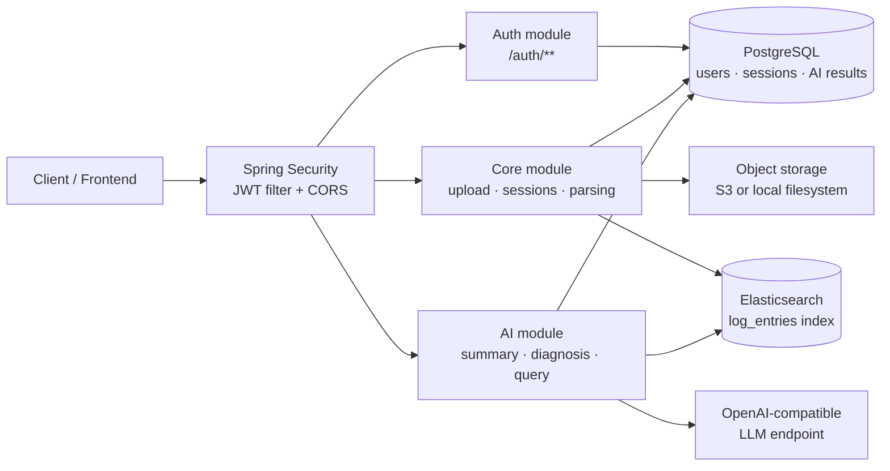
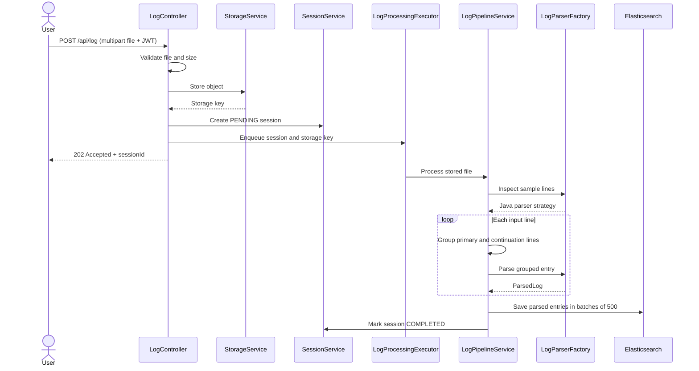
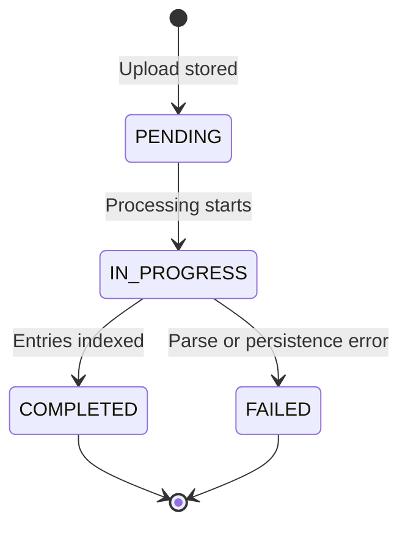
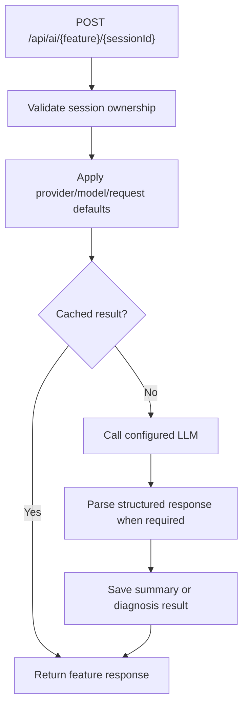
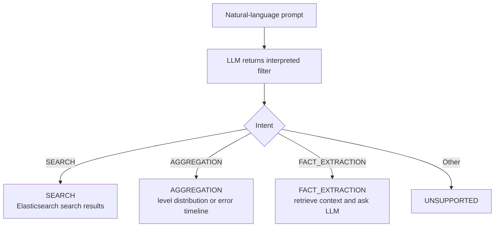

# Log Analyzer + AI

Log Analyzer is a Spring Boot service that stores application log files, parses Java log entries, indexes them in Elasticsearch, and provides AI-assisted analysis for each uploaded log session.

The service exposes a JWT-protected REST API for authentication, log session management, summaries, root-cause diagnosis, and natural-language questions about indexed logs.

## Table of Contents

1. [Implemented Features](#implemented-features)
2. [Architecture](#architecture)
3. [Processing Flow](#processing-flow)
4. [AI Analysis Flow](#ai-analysis-flow)
5. [Technology Stack](#technology-stack)
6. [API Reference](#api-reference)
7. [Configuration](#configuration)
8. [Running the Application](#running-the-application)
9. [Testing](#testing)
10. [Project Structure](#project-structure)

## Implemented Features

### Authentication and authorization

- User registration and login.
- BCrypt password hashing.
- Stateless JWT authentication.
- JWT claims for email, user ID, and role.
- Protected `/api/**` endpoints.
- CORS support for the configured local frontend origins.
- Validation for required registration and login fields.

### Log ingestion and sessions

- Multipart log upload through `POST /api/log`.
- Upload validation and a 100 MB maximum object size.
- S3-backed storage by default.
- Local filesystem storage option.
- A persistent session for each upload.
- Asynchronous processing using a bounded task executor.
- Session completion metadata including total entries, error count, warning count, detected language, and detected framework.
- Session listing, details, download, and deletion.
- Cleanup of stored files, Elasticsearch entries, and cached AI results when a session is deleted.

### Parsing and indexing

- Java parser selection through `LogParserFactory`.
- Spring Boot, Log4j, and simple Java parser strategies.
- Configurable Java regex patterns stored through `LogParserConfigService`.
- Multiline entry handling for stack traces and continuation lines.
- Elasticsearch `log_entries` documents scoped by `sessionId`.
- Batch persistence of parsed entries in groups of 500.
- Search, level distribution, error timeline, and keyword lookup support.

### AI capabilities

- Error-log summaries using up to 50 error entries.
- Root-cause diagnosis using error and warning entries.
- Natural-language query interpretation.
- Search queries returning matching log documents.
- Aggregation queries for level distribution and error timelines.
- Fact extraction using relevant log context.
- PostgreSQL persistence for summary and diagnosis results.
- Provider and model information in AI responses.

## Architecture



### Main modules

| Module | Responsibility |
|---|---|
| `auth` | Registration, login, password encoding, JWT creation, and request authentication |
| `ai` | Prompt selection, LLM calls, response parsing, AI result persistence, and query routing |
| `core.controller` | Log upload and session endpoints |
| `core.service` | Storage, session lifecycle, and asynchronous log processing |
| `core.strategy` | Parser selection and Java log parser strategies |
| `core.repository` | PostgreSQL session access and Elasticsearch log access |
| `config` | OpenAPI and application-level configuration |

## Processing Flow

Uploading a file creates a session and queues processing before returning an accepted response.



### Session lifecycle



The upload endpoint returns before processing finishes. Use `GET /api/sessions/{sessionId}` to read the current session state.

### Parsing details

1. The pipeline reads the stored file as UTF-8.
2. Up to 20 lines are collected for parser detection.
3. `LogParserFactory` selects the first parser that reports the sample as parsable.
4. A parser identifies primary log lines.
5. Non-primary lines are appended to the preceding primary line, preserving multiline stack traces.
6. Parsed entries are mapped to `LogEntryDocument`.
7. Entries are saved to Elasticsearch in batches of 500.
8. The session is completed with counts and detected metadata.

Each indexed document contains fields including:

| Field | Elasticsearch type | Description |
|---|---|---|
| `id` | Identifier | Generated document ID |
| `sessionId` | Keyword | Owning log session |
| `logTimestamp` | Date | Timestamp parsed from the log |
| `level` | Keyword | Log level |
| `message` | Text and keyword | Parsed message and multiline content |
| `thread` | Text | Thread information when available |
| `className` | Text | Class information when available |
| `pid` | Text | Process ID when available |
| `rawLog` | Text | Original grouped log content |
| `createdAt` | Date | Index document creation time |

## AI Analysis Flow



### Summary

`POST /api/ai/summarise/{sessionId}` retrieves up to 50 `ERROR` entries, sends them to the configured LLM, and returns a summary. If the session has no error entries, the service returns `No errors found in this log file.` and stores that result.

### Diagnosis

`POST /api/ai/diagnose/{sessionId}` retrieves up to 80 `ERROR` and `WARN` entries. The LLM response is parsed into `DiagnosisResponse`, including root causes and preventive information. A cached diagnosis is returned when available.

### Natural-language query

`POST /api/ai/query/{sessionId}` first asks the LLM to interpret the user prompt. The interpreted intent is routed as follows:



Supported aggregation types include `COUNT_BY_LEVEL` and `ERROR_TIMELINE`. Fact extraction uses keyword-matched entries when keywords are available, otherwise it uses the earliest indexed entries as context.

## Technology Stack

| Layer | Technology |
|---|---|
| Language | Java 21 |
| Framework | Spring Boot 3.5.6 |
| Security | Spring Security, JJWT 0.12.6, BCrypt |
| Relational data | PostgreSQL with Spring Data JPA |
| Search | Elasticsearch 8.11.0 with Spring Data Elasticsearch |
| AI integration | Spring AI 1.0.1 OpenAI-compatible client |
| Object storage | AWS SDK v2 S3 or local filesystem |
| API documentation | Springdoc OpenAPI 2.8.13 |
| Build | Maven |
| Testing | Spring Boot Test, H2, Spring Kafka Test, JaCoCo |

## API Reference

### Authentication

These endpoints are public.

| Method | Endpoint | Response |
|---|---|---|
| `POST` | `/auth/register` | `201 Created` with JWT and user details |
| `POST` | `/auth/login` | `200 OK` with JWT and user details |

Registration requires a non-blank name, valid email, and password of at least eight characters.

```json
{
  "name": "Example User",
  "email": "user@example.com",
  "password": "password123"
}
```

### Sessions

All session endpoints require:

```text
Authorization: Bearer <jwt>
```

| Method | Endpoint | Description |
|---|---|---|
| `POST` | `/api/log` | Upload a multipart file using the `file` field |
| `GET` | `/api/sessions` | List sessions with `page` and `size` parameters |
| `GET` | `/api/sessions/{sessionId}` | Read session metadata and status |
| `GET` | `/api/sessions/{sessionId}/download` | Stream the original uploaded file |
| `DELETE` | `/api/sessions/{sessionId}` | Soft-delete session metadata and remove related data |

The session list normalizes negative pages and limits page size to 100.

Upload example:

```powershell
curl.exe -X POST http://localhost:8081/api/log `
  -H "Authorization: Bearer <token>" `
  -F "file=@.\application.log"
```

### AI endpoints

| Method | Endpoint | Description |
|---|---|---|
| `POST` | `/api/ai/summarise/{sessionId}` | Summarize error entries |
| `POST` | `/api/ai/diagnose/{sessionId}` | Analyze errors and warnings |
| `POST` | `/api/ai/query/{sessionId}` | Interpret and answer a natural-language query |

The optional `LLMRequest` body supports `systemPrompt`, `userPrompt`, `maxTokens`, `temperature`, `provider`, and `model`.

```json
{
  "userPrompt": "Which errors occurred most often?",
  "provider": "NVIDIA",
  "model": "nvidia/nemotron-3.5-super-vl-120b-a12b",
  "maxTokens": 500,
  "temperature": 0.2
}
```

## Configuration

The application loads values from Spring configuration, environment variables, optional `secret.yaml`, and optional dotenv configuration.

| Variable | Purpose | Default |
|---|---|---|
| `JWT_SECRET` | Base64 signing key for JWTs | Required |
| `JWT_EXPIRATION` | JWT lifetime in milliseconds | `86400000` |
| `SPRING_DATASOURCE_URL` | PostgreSQL JDBC URL | `jdbc:postgresql://localhost:5432/log_analyzer` |
| `SPRING_DATASOURCE_USERNAME` | PostgreSQL username | `admin` |
| `SPRING_DATASOURCE_PASSWORD` | PostgreSQL password | `admin` |
| `SPRING_ELASTICSEARCH_URIS` | Elasticsearch connection URL | `http://localhost:9200` |
| `SPRING_AI_OPENAI_BASE_URL` | OpenAI-compatible LLM base URL | `https://integrate.api.nvidia.com` |
| `SPRING_AI_OPENAI_API_KEY` | LLM API key | Required for AI operations |
| `OPENAI_MODEL` | Default model | `nvidia/nemotron-3.5-super-vl-120b-a12b` |

### Storage configuration

S3 is the configured default:

```yaml
storage:
  type: s3
  key-prefix: logs
  max-object-size-bytes: 104857600
  presigned-url-ttl-minutes: 15
  bucket: ${AWS_STORAGE_BUCKET}
  region: us-east-1
  access-key: ${AWS_ACCESS_KEY_ID}
  secret-key: ${AWS_SECRET_ACCESS_KEY}
```

For local storage:

```yaml
storage:
  type: local
  local-base-dir: uploads
  local-base-url: http://localhost:8081
```

The application listens on port `8081`.

## Running the Application

### Docker Compose

The compose file starts:

- PostgreSQL with the pgvector image on port `5432`.
- Elasticsearch 8.11.0 on port `9200`.
- The application on port `8081`.

Create a `.env` file with the required secrets:

```dotenv
JWT_SECRET=replace-with-a-base64-secret
OPENAI_API_KEY=replace-with-your-api-key
```

Build the jar and start the stack:

```powershell
mvn clean package
docker compose up --build
```

The compose stack persists PostgreSQL, Elasticsearch, and local upload data in named volumes.

### Local application run

Start only the dependencies:

```powershell
docker compose up -d postgres elasticsearch
```

Start Spring Boot:

```powershell
mvn spring-boot:run
```

### OpenAPI

When the application is running:

- Swagger UI: `http://localhost:8081/swagger-ui/index.html`
- OpenAPI JSON: `http://localhost:8081/v3/api-docs`

## Testing

Run all tests:

```powershell
mvn test
```

The Maven test lifecycle also generates a JaCoCo report:

```text
target/site/jacoco/index.html
```

Tests cover authentication, JWT filtering, controllers, parsing strategies, storage, session services, Elasticsearch repositories, AI providers, and AI services.

## Project Structure

```text
src/
├── main/
│   ├── java/com/logAnalyzer/
│   │   ├── auth/
│   │   │   ├── config/       Security configuration
│   │   │   ├── controller/   Register and login endpoints
│   │   │   ├── dto/          Authentication request/response models
│   │   │   ├── entity/       User and role entities
│   │   │   ├── filter/       JWT request filter
│   │   │   └── service/      Authentication and JWT services
│   │   ├── ai/
│   │   │   ├── config/       Chat client and database vector configuration
│   │   │   ├── entity/       AI result and embedding entities
│   │   │   ├── model/        AI request and response models
│   │   │   ├── provider/     LLM provider integration
│   │   │   ├── repository/   AI persistence
│   │   │   └── service/      AI orchestration
│   │   ├── core/
│   │   │   ├── controller/   Upload, sessions, and AI endpoints
│   │   │   ├── entity/       Session and Elasticsearch documents
│   │   │   ├── repository/   Session and log repositories
│   │   │   ├── service/      Storage and processing services
│   │   │   ├── strategy/     Parser interfaces and implementations
│   │   │   └── util/         File, parser, and storage utilities
│   │   └── config/           OpenAPI configuration
│   └── resources/
│       └── application.yaml
└── test/
    └── java/com/logAnalyzer/  Unit and service tests
```
