# Log Analyzer + AI — `Ashutosh730/parser`

A Spring Boot service that ingests application log files, indexes them in **Elasticsearch**, caches AI output in **PostgreSQL**, and exposes JWT-secured endpoints for **summarization**, **root-cause diagnosis**, and **natural-language querying** of logs via an OpenAI-compatible LLM (default: NVIDIA NIM `nvidia/nemotron-3-super-120b-a12b`).

> ℹ️ **Scope note:** The consolidated source covers the `ai`, `auth`, and `ParserApplication` packages. `AIServiceImpl` references `com.logAnalyzer.core.*` (`LogEntryDocument`, `LogSessionRepository`, `LogEntryEsRepository`, `LogEntryCustomEsRepository`, `LogLevel`, exception types) and the REST controllers for upload / AI endpoints; these are **not** in the excerpt. Sections marked *(inferred)* are reconstructed from those references plus `application.yaml`, `docker-compose.yml`, and the regex presets, and should be validated against the missing files.

---

## Table of Contents

1. [Overview](#1-overview)
2. [Key Features](#2-key-features)
3. [Tech Stack](#3-tech-stack)
4. [High-Level Architecture](#4-high-level-architecture)
5. [Module Breakdown](#5-module-breakdown)
6. [Request Flows](#6-request-flows)
  - [6.1 Upload & Ingest Pipeline *(inferred)*](#61-upload--ingest-pipeline-inferred)
  - [6.2 Authentication](#62-authentication)
  - [6.3 AI Summary](#63-ai-summary)
  - [6.4 AI Diagnosis](#64-ai-diagnosis)
  - [6.5 Natural-Language Query (NLQ)](#65-natural-language-query-nlq)
  - [6.6 LLM Provider Selection](#66-llm-provider-selection)
7. [Data Model](#7-data-model)
8. [API Reference](#8-api-reference)
9. [Configuration Reference](#9-configuration-reference)
10. [Project Structure](#10-project-structure)
11. [Getting Started](#11-getting-started)
12. [Testing](#12-testing)
13. [Design Decisions](#13-design-decisions)
14. [Known Limitations & Technical Debt](#14-known-limitations--technical-debt)
15. [Roadmap](#15-roadmap)
16. [Glossary](#16-glossary)

---

## 1. Overview

**Log Analyzer** turns raw application logs into actionable insights.

- **Auth** — stateless JWT authentication with BCrypt-hashed passwords and role-based users (`USER`, `ADMIN`).
- **Ingestion** *(inferred)* — log files are uploaded, stored in S3 or on local disk, parsed line-by-line with configurable regex patterns, and bulk-indexed as documents in **Elasticsearch**. Each upload creates a `LogSession` that scopes all downstream search and AI calls.
- **AI layer** — three capabilities built on top of an OpenAI-compatible chat model:
  1. **Summary** — plain-English summary of ERROR entries (≤150 words).
  2. **Diagnosis** — structured JSON root-cause analysis with confidence scores, affected components, and prioritized fixes.
  3. **Natural-Language Query (NLQ)** — classifies a free-text question into `SEARCH` / `AGGREGATION` / `FACT_EXTRACTION` / `UNSUPPORTED` and executes the appropriate Elasticsearch query or LLM answer.
- **Caching** — results persisted in PostgreSQL (`ai_results`) keyed by `(sessionId, feature, provider, model)` so repeated calls don't re-bill the LLM.
- **Vector readiness** — `pgvector` extension auto-enabled and a `log_embeddings` table (`vector(1536)`) exists for semantic log search (not yet wired to a service).

---

## 2. Key Features

| Feature | Description |
|---|---|
| 📥 Log Upload & Ingest | Multipart upload → object storage (S3/local) → regex parsing → bulk ES index, scoped to a `LogSession`. *(inferred)* |
| 🧾 Configurable Parsers | Regex presets for Spring Boot, Log4j, and simple Java logs; multi-line stack traces folded into the parent entry. *(inferred)* |
| 🔐 JWT Auth | Register/login returns a signed JWT (`HS256`, Base64 secret). Stateless filter validates every request. |
| 🧠 AI Summary | Summarizes up to 50 ERROR logs per session. |
| 🩺 AI Diagnosis | JSON-structured root causes (≤3), each with 1–2 fixes, confidence, components, frequency, and preventive actions. |
| 💬 Natural-Language Query | Intent-aware dispatch: keyword/level/time search, level aggregation, error timeline, or direct fact extraction. |
| ♻️ Result Caching | Per-session, per-feature, per-model cache in PostgreSQL. |
| 🧩 Pluggable LLM Providers | `LLMProvider` interface + `LlmFactory`; implementations for `NVIDIA` and `OPENAI`. |
| 🐘 pgvector | `CREATE EXTENSION IF NOT EXISTS vector` on startup; embedding entity ready for semantic search. |
| 🐳 Docker Compose | Postgres (pgvector image), Elasticsearch 8.11 single-node, and the app; a named volume persists uploads. |
| 🧪 Test-friendly | H2 + `spring-kafka-test` on the test classpath, JaCoCo coverage reports. |

---

## 3. Tech Stack

| Layer | Technology |
|---|---|
| Language / Runtime | Java **21** (Docker image uses JDK 23 — see [Tech Debt](#14-known-limitations--technical-debt)) |
| Framework | Spring Boot **3.5.6** |
| AI | Spring AI **1.0.1** (`spring-ai-starter-model-openai`) — used against an OpenAI-compatible endpoint |
| Default LLM | `nvidia/nemotron-3-super-120b-a12b` via `https://integrate.api.nvidia.com` |
| Auth | Spring Security + `jjwt` **0.12.6** |
| Relational DB | PostgreSQL + **pgvector** (`pgvector/pgvector:pg15`) |
| Search | Elasticsearch **8.11.0** (Spring Data Elasticsearch) |
| Object Storage | AWS SDK v2 S3 (`software.amazon.awssdk:s3`, `:sts`) or local disk |
| Build | Maven, JaCoCo 0.8.13, `spring-dotenv` 4.0.0 |
| Container | Docker / Docker Compose |

---

## 4. High-Level Architecture

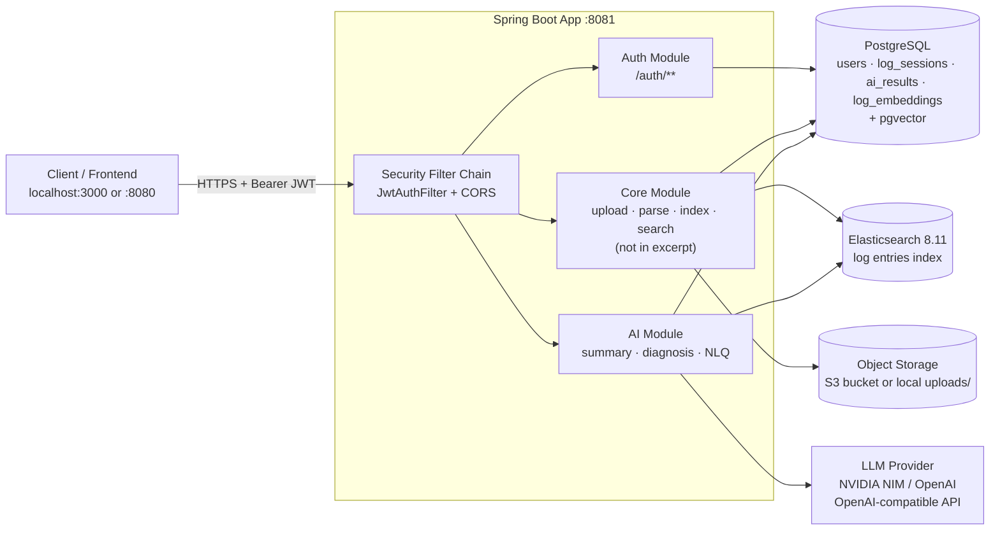

**Request path in one line:** `Client → JWT filter → controller → service → (Postgres | Elasticsearch | object storage | LLM) → response`.

---

## 5. Module Breakdown

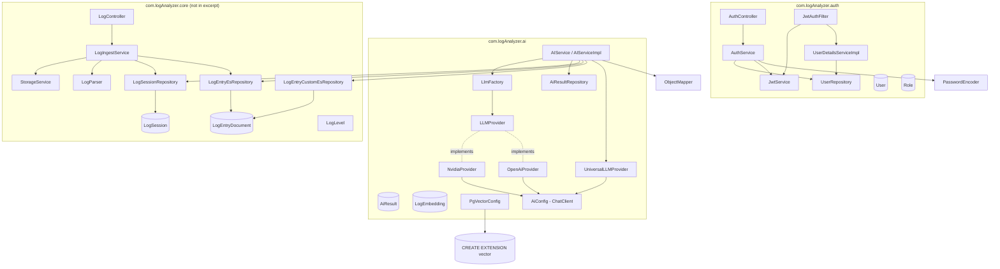

### 5.1 `auth` package

| Class | Responsibility |
|---|---|
| `SecurityConfig` | Stateless security chain, CORS (`localhost:3000`, `localhost:8080`), permits `/auth/**`, `/swagger-ui/**`, `/v3/api-docs/**`; requires auth for `/api/**`. |
| `JwtAuthFilter` | `OncePerRequestFilter`: reads `Authorization: Bearer …`, extracts email, validates, loads `UserDetails`, populates `SecurityContext`. |
| `JwtService` | Issues/parses HS256 tokens. Claims: `sub=email`, `userId`, `role`, `iat`, `exp`. |
| `AuthService` | Register (BCrypt hash, default role `USER`, immediate token) and login (delegates to `AuthenticationManager`). |
| `UserDetailsServiceImpl` | Maps `User` → Spring `UserDetails` with `ROLE_<role>`. |
| `AuthController` | `POST /auth/register`, `POST /auth/login`, `GET /auth/me`. |

### 5.2 `ai` package

| Class | Responsibility |
|---|---|
| `AIServiceImpl` | Orchestrates caching, ES retrieval, prompt construction, LLM call, deserialization. |
| `LlmFactory` | Selects an `LLMProvider` by `LlmProviderEnum`; throws if none registered. |
| `LLMProvider` | Contract: `String complete(LlmRequest)`, `LlmProviderEnum getProviderName()`. |
| `NvidiaProvider` | Calls `ChatClient` with system+user roles, `temperature=1.0`, `maxTokens=4096`; sanitizes `:free` model names. |
| `OpenAiProvider` | Flattens system+user into one string and calls `OpenAiChatModel.call(prompt)`. |
| `UniversalLLMProvider` | Standalone component used by `AIServiceImpl` for summary/diagnosis/NLQ classification. **Does not implement `LLMProvider`.** |
| `AiConfig` | Builds a single `ChatClient` bean from `OpenAiChatModel`. |
| `PgVectorConfig` | Runs `CREATE EXTENSION IF NOT EXISTS vector` on startup. |
| `AiResult` / `AiResultRepository` | JPA cache of AI responses. |
| `LogEmbedding` | `vector(1536)` entity for future semantic search. |

### 5.3 `core` package *(inferred, not in excerpt)*

| Class | Responsibility |
|---|---|
| `LogController` | `POST /api/logs/upload` (multipart), `GET /api/logs`, `GET /api/logs/{sessionId}`, `DELETE /api/logs/{sessionId}`, `GET /api/logs/{sessionId}/download`. |
| `LogIngestService` | Orchestrates validate → store → parse → bulk index → session status update. |
| `StorageService` | Strategy for `storage.type = s3 \| local`: `put`, `get`, `presignedUrl`, `delete`. |
| `LogParser` | Applies the configured regex, extracts named groups, folds continuation lines. |
| `LogSession` | Upload metadata: `id`, `userId`, `filename`, `sizeBytes`, `format`, `status`, per-level counts, `createdAt`. |
| `LogEntryDocument` | ES document: `sessionId`, `level`, `logTimestamp`, `message`, `className`, `thread`, etc. |
| `LogEntryEsRepository` | Spring Data derived queries (`findBySessionIdAndLevelIn`, `findBySessionIdOrderByLogTimestampAsc`). |
| `LogEntryCustomEsRepository` | Native ES queries: `getSearchResult`, `getLevelDistribution`, `getErrorTimeline`, `findBySessionIdAndKeywords`. |
| Exceptions | `SessionNotFoundException`, `AiResponseParseException`, `EmailAlreadyExistsException`. |

---

## 6. Request Flows

### 6.1 Upload & Ingest Pipeline *(inferred)*

> ⚠️ **Entirely reconstructed.** The upload controller, `LogIngestService`, `StorageService`, and `LogParser` are **not** in the provided excerpt. This section is derived from:
> - `application.yaml`: `storage.*`, `file.upload-dir`, `log.format.java.*` regex presets
> - `docker-compose.yml`: `log_uploads:/app/uploads` volume + S3 SDK dependency in `pom.xml`
> - `AIServiceImpl`: `LogSessionRepository.findByIdAndUserId`, `LogEntryEsRepository.findBySessionIdAndLevelIn`, `LogEntryDocument.getLevel/getMessage/getLogTimestamp`
> - The absence of `@Async`, Spring Batch, or active Kafka config → the pipeline is **synchronous**, not streaming.

#### 6.1.1 End-to-end flowchart

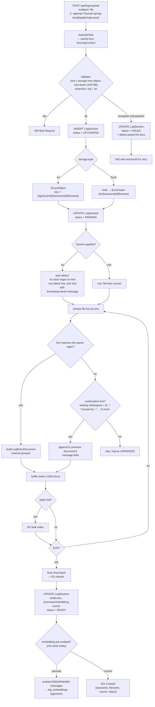

#### 6.1.2 Sequence diagram

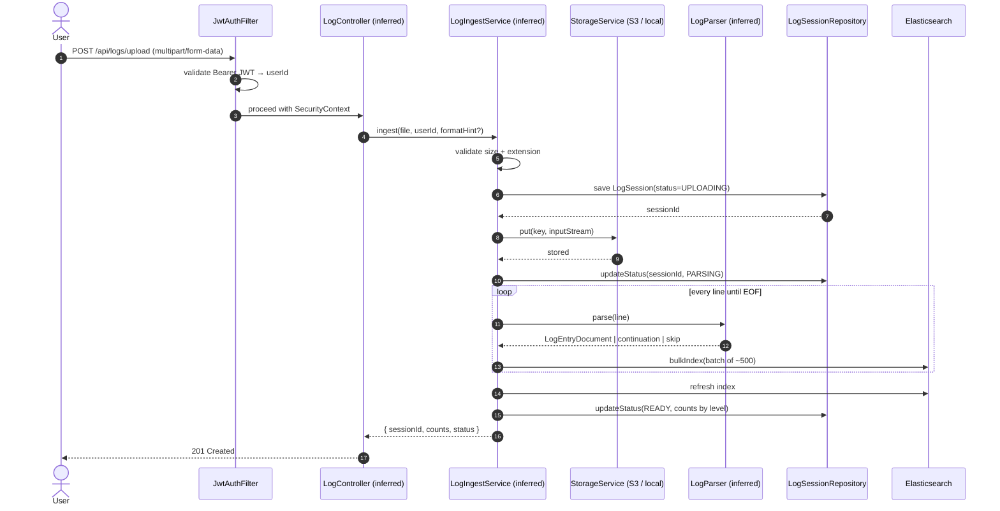

#### 6.1.3 Format detection & parsing

The three presets in `application.yaml` all expose the same named groups (`timestamp`, `level`, `className`, `message`) plus format-specific extras:

| Preset | `timestamp` | `level` | `className` | `message` | Extras |
|---|---|---|---|---|---|
| `spring-boot` | ✓ | ✓ | ✓ | ✓ | `pid`, `context`, `thread` |
| `log4j` | ✓ | ✓ | ✓ | ✓ | `thread` |
| `simple-java` | ✓ | ✓ | ✓ | ✓ | `method` |

**Auto-detection** *(inferred)*: test each preset's regex against the first non-blank line; the first pattern that yields non-null `timestamp` + `level` + `message` wins. The chosen preset is persisted on `LogSession.format` so re-parsing is reproducible.

**Multi-line handling.** Java stack traces span many lines, e.g.:

```
2026-10-17 09:12:44 ERROR 8123 --- [http-nio-8080-exec-1] [ ] c.e.OrderService : Payment failed
java.lang.NullPointerException: null
    at com.example.OrderService.charge(OrderService.java:88)
    at com.example.OrderController.checkout(OrderController.java:41)
Caused by: java.sql.SQLTimeoutException: Connection is not available
    ...
```

Lines that don't match the header regex are **continuation lines** — appended to the previous `LogEntryDocument.message` (usually joined with `\n`) so the trace travels with its error level and timestamp. Heuristics for "is continuation": leading whitespace, starts with `at `, `Caused by:`, `... N more`, `Suppressed:`.

> 💡 Note the `simple-java` regex contains a literal `\n` in the middle — it expects a 2-line block (`Header\nLEVEL: message`). This preset therefore needs a block-aware reader, not a pure line-reader. See [Tech Debt](#14-known-limitations--technical-debt).

#### 6.1.4 Storage key layout

| `storage.type` | Object key / path | Retrieval |
|---|---|---|
| `s3` | `logs/{userId}/{sessionId}/{originalFilename}` | Presigned GET, TTL `presigned-url-ttl-minutes` (15 min) |
| `local` | `{local-base-dir}/{sessionId}/{originalFilename}` → `uploads/{sessionId}/…` | Static URL `{local-base-url}/uploads/…` |

Docker Compose mounts `log_uploads:/app/uploads`, so local uploads survive container restarts in the compose stack.

#### 6.1.5 Elasticsearch index shape *(inferred)*

```json
{
  "mappings": {
    "properties": {
      "sessionId":    { "type": "keyword" },
      "level":        { "type": "keyword" },
      "logTimestamp": { "type": "date" },
      "className":    { "type": "keyword" },
      "thread":       { "type": "keyword" },
      "message":      { "type": "text" }
    }
  }
}
```

`sessionId` as `keyword` keeps every query scoped and cheap; `message` as `text` allows the NLQ `SEARCH` intent's keyword filters to hit the analyzer.

#### 6.1.6 Session state machine

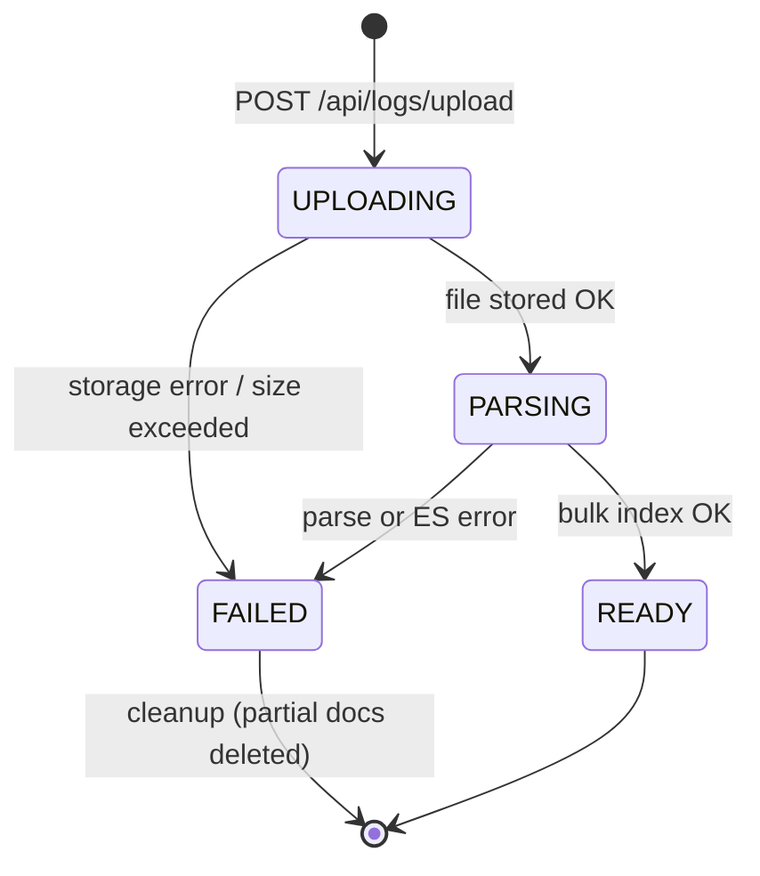

Only `READY` sessions should be accepted by `/api/ai/*` — `AIServiceImpl.validateSessionOwnership` today only checks ownership, **not** status; adding the status check is a roadmap item.

#### 6.1.7 Failure modes

| Failure | Where | Behaviour |
|---|---|---|
| File > 100 MB | Validation | `400`, no session created |
| Unsupported extension | Validation | `400`, no session created |
| S3/local put fails | Storage | `LogSession` → `FAILED`, `500` |
| Regex doesn't match any preset | Detection | `LogSession` → `FAILED`, `422` with "unrecognized log format" |
| ES bulk partially rejects | Indexing | `LogSession` → `FAILED`, partial docs deleted |
| Client disconnects mid-upload | Servlet | Session left in `UPLOADING` — needs a reaper job (see roadmap) |

#### 6.1.8 Where Kafka would slot in (currently disabled)

`pom.xml` still declares `spring-kafka` and the compose file has a commented Kafka block. The intended evolution is:

```
upload → store object + create LogSession(UPLOADING)
       → publish {sessionId, objectKey} to `log-ingest` topic
       → consumer parses + bulk indexes
       → updates LogSession → READY
       → (optional) emits `log-ingested` event → AI auto-summary
```

Today the whole pipeline is **synchronous inside the HTTP request** — fine for typical <10 MB app logs, risky for the 100 MB ceiling.

---

### 6.2 Authentication

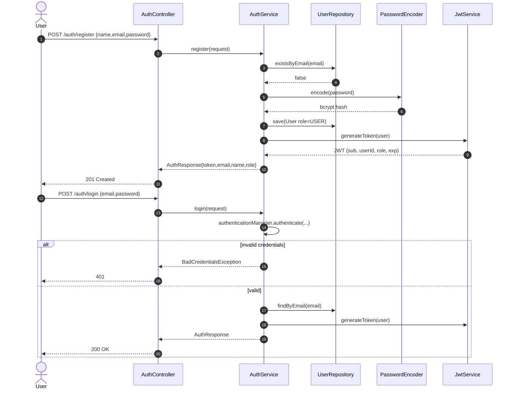

**Every subsequent request:**

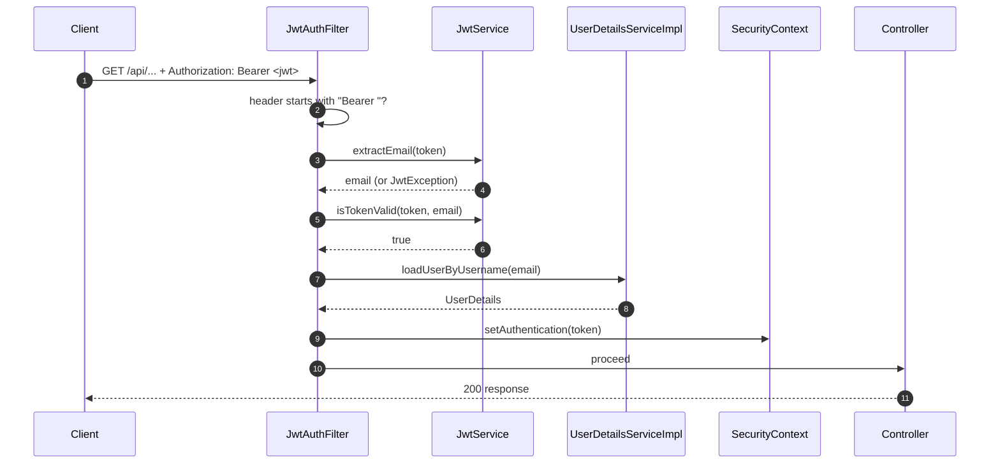

### 6.3 AI Summary

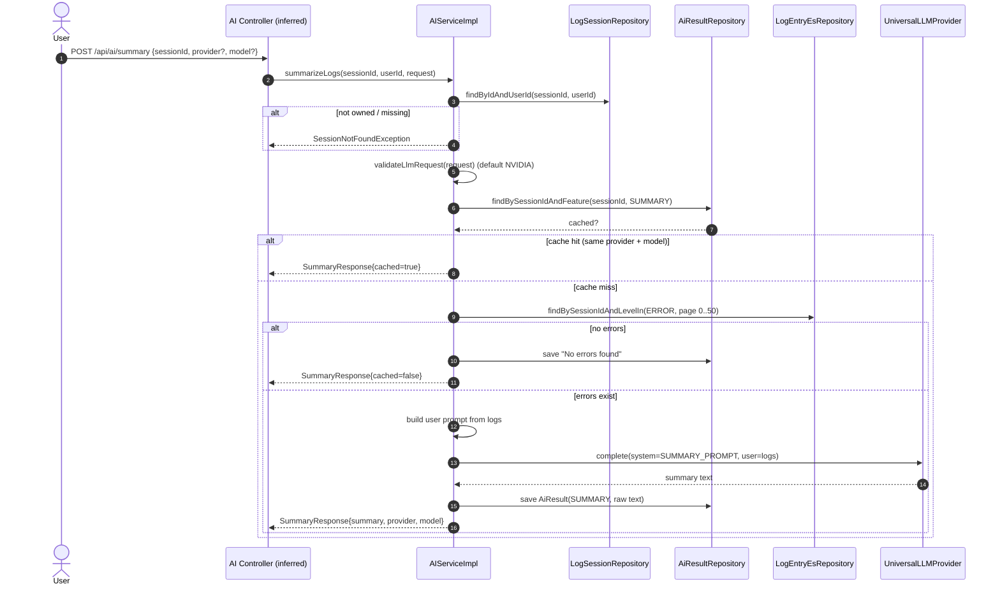

### 6.4 AI Diagnosis

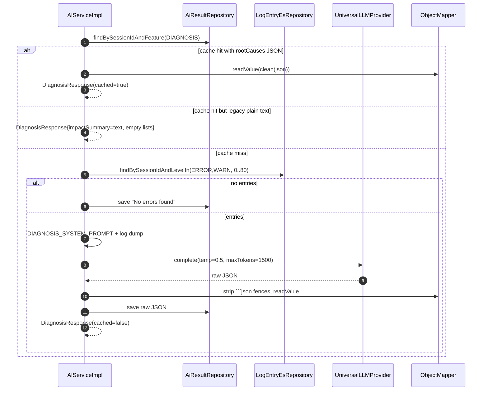

**Expected diagnosis JSON shape** (enforced by the system prompt):

```json
{
  "rootCauses": [
    {
      "cause": "HikariCP pool exhausted under peak load",
      "confidence": 0.91,
      "affectedComponents": ["OrderService", "DataSource"],
      "firstOccurrence": "2026-10-17T09:12:44Z",
      "frequency": 37,
      "fixes": [
        {
          "suggestion": "Increase HikariCP maximum-pool-size to 20",
          "category": "CONFIGURATION",
          "priority": "HIGH"
        }
      ]
    }
  ],
  "timeline": "Pool saturation began ~09:12, cascaded to 5xx at 09:14",
  "impactSummary": "Checkout API 5xx rate spiked to 12% for 8 minutes",
  "preventiveActions": ["Add pool-utilization alert at 80%"]
}
```

### 6.5 Natural-Language Query (NLQ)

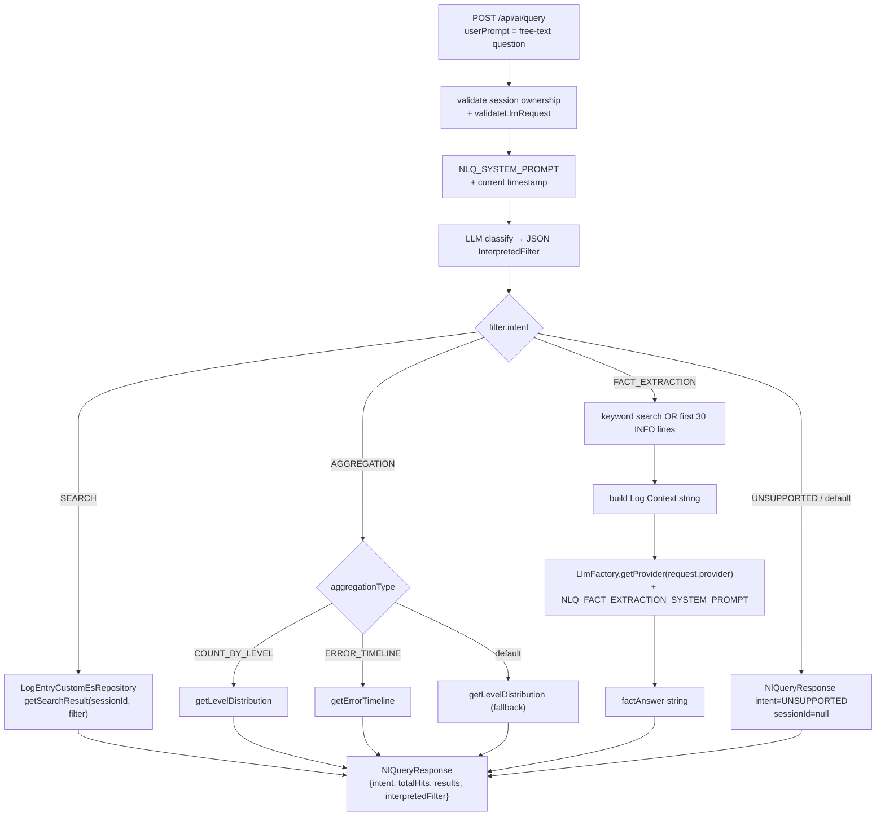

> `TOP_ERRORS` is referenced in the prompt but commented out in `handleAggregation`.

**Intent classification rules baked into the prompt**

| Intent | Trigger examples | Behaviour |
|---|---|---|
| `SEARCH` | "show me database errors", "find NPE exceptions" | Extract keywords, levels, time range, className → ES search |
| `AGGREGATION` | "how many errors", "top errors", "error trend" | `COUNT_BY_LEVEL` \| `TOP_ERRORS` \| `ERROR_TIMELINE`; keywords forced to `[]` |
| `FACT_EXTRACTION` | "which port is running", "which Java version" | Fetch context logs → LLM answers directly (`temperature=0`) |
| `UNSUPPORTED` | "delete logs", "fix this error" | No ES access, no LLM call |

### 6.6 LLM Provider Selection

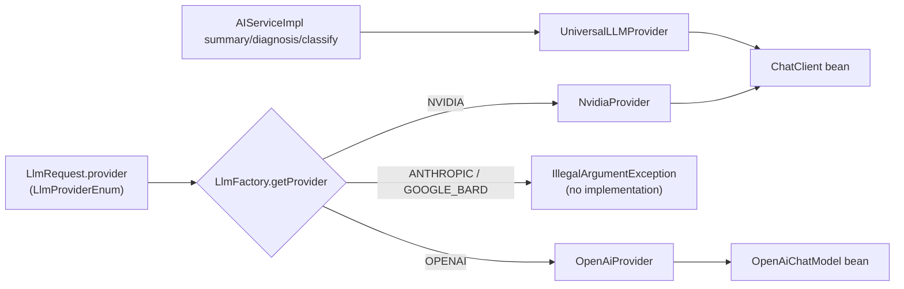

> Two parallel strategies coexist: `LLMProvider` + `LlmFactory` (used only by FACT_EXTRACTION) and the standalone `UniversalLLMProvider` (used everywhere else). See [Tech Debt](#14-known-limitations--technical-debt).

---

## 7. Data Model

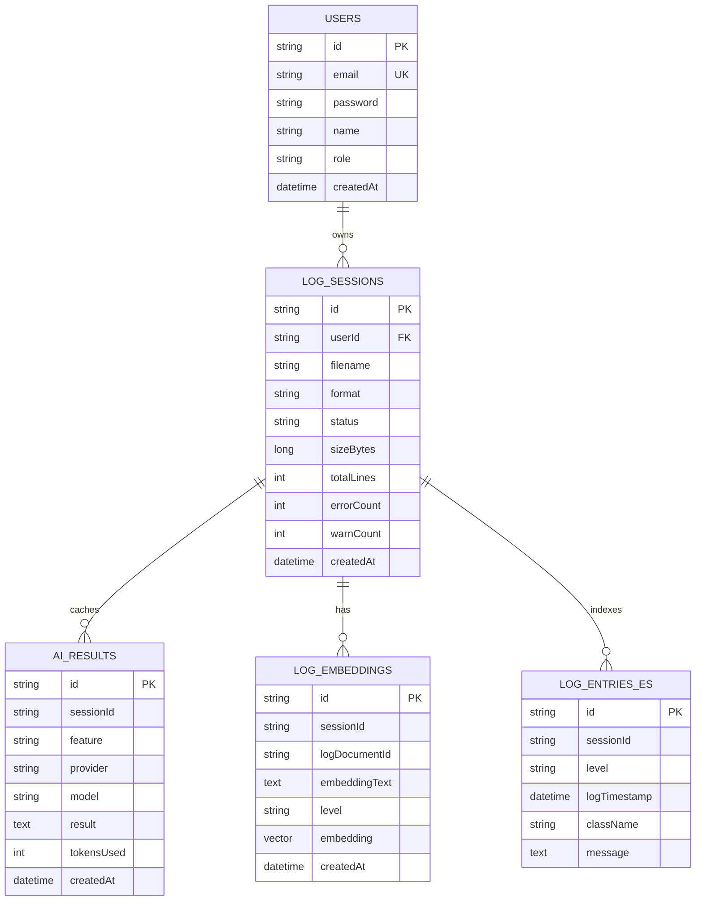

> `LOG_SESSIONS` and `LOG_ENTRIES_ES` are **inferred** from repository usage in `AIServiceImpl` plus the ingest pipeline reconstruction; the entities live in the missing `core` package.

### Cache key semantics

The cache is effectively keyed on `(sessionId, feature, provider, model)`:

```java
aiResultRepository.findBySessionIdAndFeature(sessionId, feature)
    .stream()
    .filter(r -> r.getProvider().equals(request.getProvider())
              && r.getModel().equals(request.getModel()))
    .findAny();
```

- No TTL — cached results live forever unless `deleteBySessionId` is called.
- `NATURAL_LANGUAGE_QUERY` is a valid `AiFeatureEnum` but **is never written** (NLQ isn't cached).
- `tokensUsed` is populated with `request.getMaxTokens()` (the *budget*, not actual usage).

---

## 8. API Reference

### Auth (confirmed from `AuthController`)

| Method | Path | Auth | Body | Response |
|---|---|---|---|---|
| `POST` | `/auth/register` | ❌ | `{ "name", "email", "password" }` | `201` `{ token, email, name, role }` |
| `POST` | `/auth/login` | ❌ | `{ "email", "password" }` | `200` `{ token, email, name, role }` |
| `GET` | `/auth/me` | ✅ (permitted but needs principal) | — | `"<email> [ROLE_X]"` |

### Log ingest *(inferred — controller not in the excerpt)*

| Method | Path | Purpose |
|---|---|---|
| `POST` | `/api/logs/upload` | Multipart upload; optional `?format=spring-boot\|log4j\|simple-java` |
| `GET` | `/api/logs` | List the caller's sessions |
| `GET` | `/api/logs/{sessionId}` | Session metadata (status, counts) |
| `GET` | `/api/logs/{sessionId}/download` | Presigned URL / static URL for the original file |
| `DELETE` | `/api/logs/{sessionId}` | Delete session, ES docs, stored object, cached AI results |

**Upload request**

```bash
curl -X POST localhost:8081/api/logs/upload \
  -H "Authorization: Bearer $TOKEN" \
  -F "file=@app.log" \
  -F "format=spring-boot"        # optional
```

**Upload response (suggested shape)**

```json
{
  "sessionId": "3f8c...",
  "filename": "app.log",
  "sizeBytes": 482391,
  "format": "spring-boot",
  "status": "READY",
  "counts": { "total": 12043, "ERROR": 37, "WARN": 112, "INFO": 11851, "DEBUG": 43 },
  "createdAt": "2026-10-17T11:46:51Z"
}
```

### AI endpoints *(inferred — controllers not in the excerpt)*

| Method | Path | Purpose | Service method |
|---|---|---|---|
| `POST` | `/api/ai/summary` | Summarize ERROR logs | `AIService.summarizeLogs` |
| `POST` | `/api/ai/diagnosis` | Root-cause analysis | `AIService.analyse` |
| `POST` | `/api/ai/query` | Natural-language query | `AIService.queryProcessor` |

**Suggested request body** (matches `LlmRequest` + `sessionId`):

```json
{
  "sessionId": "3f8c...",
  "systemPrompt": null,
  "userPrompt": "show me database timeouts from last night",
  "maxTokens": 300,
  "temperature": 0.2,
  "provider": "NVIDIA",
  "model": "nvidia/nemotron-3-super-120b-a12b"
}
```

**Response shapes**

<details>
<summary><code>SummaryResponse</code></summary>

```json
{
  "sessionId": "…",
  "summary": "…",
  "cached": false,
  "provider": "NVIDIA",
  "model": "nvidia/nemotron-3-super-120b-a12b"
}
```
</details>

<details>
<summary><code>DiagnosisResponse</code></summary>

```json
{
  "sessionId": "…",
  "timeline": "…",
  "provider": "NVIDIA",
  "model": "…",
  "cached": false,
  "impactSummary": "…",
  "rootCauses": [
    {
      "cause": "…",
      "confidence": 0.9,
      "affectedComponents": ["OrderService"],
      "firstOccurrence": "2026-10-17T09:12:44Z",
      "frequency": 12,
      "fixes": [
        { "suggestion": "…", "category": "CONFIGURATION", "priority": "HIGH" }
      ]
    }
  ],
  "preventiveActions": ["…"]
}
```
</details>

<details>
<summary><code>NlQueryResponse</code></summary>

```json
{
  "sessionId": "…",
  "originalQuery": "how many errors yesterday?",
  "intent": "AGGREGATION",
  "totalHits": 0,
  "provider": "NVIDIA",
  "model": "…",
  "aggregationResult": { "ERROR": 42, "WARN": 7 },
  "interpretedFilter": {
    "intent": "AGGREGATION",
    "levels": ["ERROR"],
    "timeFrom": "…",
    "timeTo": "…",
    "aggregationType": "COUNT_BY_LEVEL",
    "explanation": "…"
  },
  "results": null
}
```
</details>

---

## 9. Configuration Reference

### Environment variables

| Variable | Default | Used by |
|---|---|---|
| `SPRING_AI_OPENAI_BASE_URL` / `OPENAI_BASE_URL` | `https://integrate.api.nvidia.com` | Spring AI client |
| `SPRING_AI_OPENAI_API_KEY` / `OPENAI_API_KEY` | *(empty)* | LLM calls |
| `OPENAI_MODEL` | `nvidia/nemotron-3-super-120b-a12b` | `NvidiaProvider`, `UniversalLLMProvider` |
| `SPRING_DATASOURCE_URL` | `jdbc:postgresql://localhost:5432/log_analyzer` | JPA |
| `SPRING_DATASOURCE_USERNAME` / `_PASSWORD` | `admin` / `admin` | JPA |
| `SPRING_ELASTICSEARCH_URIS` | `http://localhost:9200` | Spring Data ES |
| `JWT_SECRET` | **required** (no default) | `JwtService` — must be Base64 |
| `JWT_EXPIRATION` | `86400000` (24 h) | `JwtService` |
| `AWS_ACCESS_KEY_ID` / `AWS_SECRET_ACCESS_KEY` | — | S3 storage |
| `CLAUDE_API_KEY` | — | Reserved, unused |

Spring also imports `optional:file:./secret.yaml` and `optional:dotenv:.`, so a local `secret.yaml` or `.env` is picked up automatically.

### Key `application.yaml` excerpts

```yaml
spring:
  ai:
    openai:
      base-url: ${SPRING_AI_OPENAI_BASE_URL:${OPENAI_BASE_URL:https://integrate.api.nvidia.com}}
      api-key: ${SPRING_AI_OPENAI_API_KEY:${OPENAI_API_KEY:}}
      chat.options.model: ${OPENAI_MODEL:nvidia/nemotron-3-super-120b-a12b}
  jpa:
    hibernate.ddl-auto: update
    properties.hibernate.jdbc.time_zone: UTC
  jackson.time-zone: UTC

file:
  upload-dir: parser/src/main/resources/uploads

storage:
  type: s3                       # or local
  key-prefix: logs
  bucket: ashutosh-log-analyzer-bucket
  region: us-east-1
  endpoint: ""
  path-style-access: false
  access-key: ${AWS_ACCESS_KEY_ID}
  secret-key: ${AWS_SECRET_ACCESS_KEY}
  local-base-dir: uploads
  local-base-url: http://localhost:8081
  max-object-size-bytes: 104857600   # 100 MB
  presigned-url-ttl-minutes: 15

log:
  format.java:
    spring-boot: '^(?<timestamp>\S+)\s+(?<level>\w+)\s+(?<pid>\d+)\s+---\s+\[(?<context>.*?)\]\s+\[(?<thread>.*?)\]\s+(?<className>\S+)\s+:\s+(?<message>.*)$'
    log4j:       '…'
    simple-java: '…'

jwt:
  secret: ${JWT_SECRET}
  expiration: ${JWT_EXPIRATION:86400000}

server.port: 8081
```

Kafka config is present but **commented out**; `spring-kafka` is still on the classpath.

---

## 10. Project Structure

```
Ashutosh730/parser/
├── src/main/java/com/logAnalyzer/
│   ├── ParserApplication.java              # sets TZ=UTC, boots Spring
│   ├── ai/
│   │   ├── config/       AiConfig, PgVectorConfig
│   │   ├── entity/       AiResult, LogEmbedding
│   │   ├── enums/        AiFeatureEnum, LlmProviderEnum, QueryIntent
│   │   ├── model/        DiagnosisResponse, InterpretedFilter, LlmRequest,
│   │   │                 NlQueryResponse, SummaryResponse
│   │   ├── provider/     LLMProvider, LlmFactory, UniversalLLMProvider
│   │   │   └── impl/     NvidiaProvider, OpenAiProvider
│   │   ├── repository/   AiResultRepository
│   │   └── service/      AIService, impl/AIServiceImpl
│   ├── auth/
│   │   ├── config/       SecurityConfig
│   │   ├── controller/   AuthController
│   │   ├── dto/          AuthResponse, LoginRequest, RegisterRequest
│   │   ├── entity/       Role, User
│   │   ├── filter/       JwtAuthFilter
│   │   ├── repository/   UserRepository
│   │   └── service/      AuthService, JwtService, UserDetailsServiceImpl
│   └── core/                                # NOT in excerpt — inferred
│       ├── controller/   LogController, AiController
│       ├── entity/       LogSession, LogEntryDocument
│       ├── enums/        LogLevel, LogFormat, SessionStatus
│       ├── exception/    SessionNotFound, AiResponseParse, EmailAlreadyExists, …
│       ├── parser/       LogParser (regex + continuation-line folding)
│       ├── storage/      StorageService + S3StorageService / LocalStorageService
│       ├── service/      LogIngestService
│       └── repository/   LogSessionRepository, LogEntryEsRepository,
│                         LogEntryCustomEsRepository
├── src/main/resources/application.yaml
├── Dockerfile
├── docker-compose.yml
└── pom.xml
```

---

## 11. Getting Started

### Prerequisites

- JDK 21, Maven 3.9+
- Docker + Docker Compose (recommended) **or** local Postgres 15 with pgvector + Elasticsearch 8.11
- An API key for the OpenAI-compatible LLM endpoint (NVIDIA NIM by default)

### Option A — Docker Compose (recommended)

```bash
# 1. Provide secrets
export JWT_SECRET="$(openssl rand -base64 64)"
export OPENAI_API_KEY="nvapi-..."
# optional: export OPENAI_BASE_URL=https://api.openai.com
# optional: export OPENAI_MODEL=gpt-4o-mini

# 2. Build the jar, then bring up the stack
mvn clean package -DskipTests
docker compose up --build
```

Services:

| Service | Port | Notes |
|---|---|---|
| `app` | `8081` | Spring Boot; `log_uploads:/app/uploads` persisted |
| `postgres` | `5432` | `pgvector/pgvector:pg15`, DB/user/pass = `log_analyzer`/`admin`/`admin` |
| `elasticsearch` | `9200` | Single-node, security disabled (dev only) |

### Option B — Local development

```bash
# Start dependencies only
docker compose up -d postgres elasticsearch

# Run the app via your IDE or:
mvn spring-boot:run \
  -Dspring-boot.run.env.JWT_SECRET="$(openssl rand -base64 64)" \
  -Dspring-boot.run.env.OPENAI_API_KEY="nvapi-..."
```

### Smoke test (full pipeline)

```bash
# 1. Register → capture token
TOKEN=$(curl -s -X POST localhost:8081/auth/register \
  -H 'Content-Type: application/json' \
  -d '{"name":"Ada","email":"ada@example.com","password":"s3cret!"}' | jq -r .token)

# 2. Upload a log file → capture sessionId
SID=$(curl -s -X POST localhost:8081/api/logs/upload \
  -H "Authorization: Bearer $TOKEN" \
  -F "file=@app.log" | jq -r .sessionId)

# 3. Summarize
curl -s -X POST localhost:8081/api/ai/summary \
  -H "Authorization: Bearer $TOKEN" \
  -H 'Content-Type: application/json' \
  -d "{\"sessionId\":\"$SID\"}" | jq

# 4. Natural-language query
curl -s -X POST localhost:8081/api/ai/query \
  -H "Authorization: Bearer $TOKEN" \
  -H 'Content-Type: application/json' \
  -d "{\"sessionId\":\"$SID\",\"userPrompt\":\"how many errors happened?\"}" | jq
```

---

## 12. Testing

- `spring-boot-starter-test`, `spring-kafka-test`, and H2 are on the test classpath.
- **JaCoCo** runs `prepare-agent` + `report` on `test`; report at `target/site/jacoco/index.html`.
- Surefire is configured with `-Duser.timezone=UTC` (matching `ParserApplication`'s static `TimeZone.setDefault`).
- Suggested focus areas:
  - **Ingest** *(inferred)*: format auto-detection; continuation-line folding (stack traces); 100 MB size rejection; storage strategy switch.
  - `JwtService` round-trip (issue → parse → validate → expiry).
  - `AuthService` duplicate-email path.
  - `AIServiceImpl.deserialize` (markdown-fence stripping + null handling).
  - `UniversalLLMProvider.resolveEffectiveModel` (`:free` sanitization).
  - The intent-dispatch branch in `queryProcessor`.

```bash
mvn test
```

---

## 13. Design Decisions

| Decision | Rationale |
|---|---|
| **Session-scoped everything** | Every log entry, AI result, and embedding carries a `sessionId` — one upload = one analysis unit; ownership is a single lookup. |
| **Regex presets, not a parser DSL** | Three named groups (`timestamp`, `level`, `message`) cover the vast majority of Java app logs; new formats are a config change, not a code change. |
| **Continuation-line folding** | Stack traces are the highest-value signal in Java logs; folding them into the parent error preserves level + timestamp for AI context. |
| **Stateless JWT** | Horizontal scaling without sticky sessions; `SecurityContext` populated per request by `JwtAuthFilter`. |
| **Cache AI results in Postgres** | LLM calls are slow and costly; repeat summary/diagnosis for the same session is idempotent. Filtering on provider+model allows side-by-side comparison. |
| **JSON-mode prompt for diagnosis** | Structured output is easier to render and prevents hallucinated prose; `deserialize` strips markdown fences because models often wrap JSON in code blocks. |
| **Two-stage NLQ** | A cheap classification call (`temperature=0.2`) before executing ES is far cheaper than giving the model raw logs for every question. `FACT_EXTRACTION` uses a second, tiny call (`maxTokens=150`, `temperature=0`). |
| **`UniversalLLMProvider`** | Single `ChatClient` bean works for any OpenAI-compatible endpoint (NVIDIA NIM, OpenAI, others), so no per-vendor SDK. |
| **`pgvector` auto-init** | `DataSourceInitializer` makes local onboarding zero-config. |
| **UTC everywhere** | `TimeZone.setDefault`, JVM args, Jackson, and Hibernate `jdbc.time_zone` all pinned to UTC to keep log timestamps comparable. |
| **Provider/model sanitization** | `resolveEffectiveModel` drops `:free` model suffixes, which some gateways reject. |

---

## 14. Known Limitations & Technical Debt

### Ingestion *(inferred)*

0a. **Synchronous pipeline.** No `@Async`, Spring Batch, or active Kafka — a 100 MB upload blocks the HTTP thread. Move to async job + `GET /api/logs/{sessionId}` polling.
0b. **`simple-java` regex expects a 2-line block** (`Header\nLEVEL: message`), so a pure line-reader can't handle it. Needs a block-aware mode or a rewrite of the pattern.
0c. **Orphaned sessions.** A client disconnect mid-upload leaves `status = UPLOADING` forever; no reaper job.
0d. **No AI-readiness gate.** `AIServiceImpl` only checks ownership, not `LogSession.status == READY`, so AI calls on a partially-indexed session can return misleading results.
0e. **Partial-ES cleanup is unverified.** On parse failure, half-indexed docs for the session must be deleted; the exact cleanup path isn't visible.

### Correctness bugs

1. **`UniversalLLMProvider` ignores its sanitized model.** It computes `effectiveModel = resolveEffectiveModel(...)` but then calls `.model(model)` (the field), so requests with an explicit model are silently overridden by `OPENAI_MODEL`.
2. **`validateLlmRequest` can discard the user prompt.** If `provider` or `model` is `null`, it returns a *brand-new* `LlmRequest` without `userPrompt`, so NLQ questions can be lost. It should copy fields, not rebuild.
3. **`GET /auth/me` is `permitAll` but dereferences `userDetails`.** With no token, `userDetails` is `null` → NPE → HTTP 500 instead of 401.
4. **NLQ system prompt typo.** `"AGGREGATION | "UNSUPPORTED` — missing closing quote and inconsistent with `QueryIntent` (enum has `NOT_RECOGNIZED`, prompt emits `UNSUPPORTED`). The `switch` default catches both, but the prompt is a malformed JSON schema.
5. **Unchecked cast in `deserialize` null branch.** `(T) InterpretedFilter.builder()…` will `ClassCastException` if `T` is `DiagnosisResponse`.

### Architectural inconsistencies

6. **Two provider strategies.** `UniversalLLMProvider` doesn't implement `LLMProvider` and isn't in `LlmFactory`, yet it handles 3 of 4 AI features. `OpenAiProvider`/`NvidiaProvider` are only used for `FACT_EXTRACTION`. Consolidate on one.
7. **`OpenAiProvider` flattens roles.** `systemPrompt + "\n" + userPrompt` loses system/user separation; prefer `ChatClient.prompt().system(...).user(...)` like `NvidiaProvider`.
8. **Only `OPENAI` and `NVIDIA` are implemented** though the enum declares `ANTHROPIC` and `GOOGLE_BARD`; `LlmFactory` will throw for those.
9. **`AiFeatureEnum.NATURAL_LANGUAGE_QUERY` exists but NLQ is never cached.** Either cache it or remove the enum value.
10. **`tokensUsed` stores `maxTokens`**, not actual usage — misleading analytics.

### Configuration / ops

11. **`JWT_SECRET` has no default.** `docker compose up` without exporting it fails on startup. Consider failing fast with a clear message or generating one for dev.
12. **`ddl-auto: update`** is unsafe for production; migrate to Flyway/Liquibase.
13. **Hibernate dialect placement.** `spring.jpa.hibernate.dialect` is nested incorrectly; the effective setting is `spring.jpa.database-platform`.
14. **Dockerfile uses `eclipse-temurin:23-jdk-alpine`** while `pom.xml` targets Java 21. Align to `21-jdk-alpine`.
15. **Elasticsearch security disabled** in compose — explicitly dev-only; never expose this config publicly.
16. **CORS hard-coded** to `localhost:3000` / `localhost:8080`; make configurable via `app.cors.allowed-origins`.
17. **No TTL on `ai_results`.** Long-lived sessions accumulate stale analyses. Add a scheduled purge or `expires_at`.
18. **No rate limiting** on `/auth/*`, `/api/logs/*`, or `/api/ai/*` — LLM spend, storage abuse, and brute-force risk.
19. **Unused imports / dead code:** `org.antlr.v4.runtime.misc.InterpreterDataReader`, commented-out `TOP_ERRORS` branch, unused Kafka config.

### Missing from the excerpt

20. **`core` package, ingest service, and controllers** are absent, so upload/parse/search endpoints can't be documented authoritatively. They are required for the service to compile.
21. **S3 code** is not present despite AWS SDK deps and `storage.type: s3`.
22. **`LogEmbedding` isn't wired** to any repository or service — pgvector is provisioned but unused.

---

## 15. Roadmap

### Ingestion

- [ ] Move ingest off the HTTP thread: enqueue `{sessionId, objectKey}` (Kafka or DB-backed job), add `GET /api/logs/{sessionId}/status`.
- [ ] Add a reaper for sessions stuck in `UPLOADING` / `PARSING` past a threshold.
- [ ] Support block-aware parsing for the `simple-java` preset (2-line header).
- [ ] Enforce `LogSession.status == READY` before any AI call.
- [ ] Auto-detect preset from the first 100 lines and record it on the session.
- [ ] Optional: extract per-session top-N messages during ingest for fast `TOP_ERRORS`.

### AI

- [ ] Unify provider strategy around `LLMProvider` + `LlmFactory`; delete or adapt `UniversalLLMProvider`.
- [ ] Fix model override and `validateLlmRequest` prompt-preservation bugs.
- [ ] Implement semantic search using `LogEmbedding` + pgvector (`ORDER BY embedding <-> query`).
- [ ] Enable `TOP_ERRORS` aggregation.
- [ ] Cache NLQ results (or drop the enum value).
- [ ] Track real token usage via Spring AI `ChatResponse` metadata.

### Platform

- [ ] Add Flyway migrations; drop `ddl-auto: update`.
- [ ] Rate-limit `/auth/*`, `/api/logs/*`, `/api/ai/*` (Bucket4j / Resilience4j).
- [ ] Add observability: Micrometer + OpenTelemetry for ingest duration, ES latency, LLM cost.
- [ ] Introduce prompt versioning and golden-file tests for diagnosis JSON.

---

## 16. Glossary

| Term | Meaning |
|---|---|
| **Session** | One uploaded log file and its derived analyses, owned by a user; scopes every ES query and AI call. |
| **Ingest pipeline** | Validate → store → parse → bulk-index → mark session READY. *(inferred)* |
| **Preset** | One of `spring-boot`, `log4j`, `simple-java` — a named regex with groups `timestamp`/`level`/`message`. |
| **Continuation line** | A line that doesn't match the header regex and is folded into the previous entry's message (stack trace frames, `Caused by:`). |
| **NLQ** | Natural-Language Query — free-text question translated into ES queries or a direct answer. |
| **InterpretedFilter** | The structured JSON the LLM returns from NLQ: intent, keywords, levels, time range, className, aggregationType. |
| **Intent** | One of `SEARCH`, `AGGREGATION`, `FACT_EXTRACTION`, `UNSUPPORTED` (enum also has `NOT_RECOGNIZED`). |
| **NIM** | NVIDIA Inference Microservices — the default OpenAI-compatible LLM endpoint. |
| **pgvector** | PostgreSQL extension providing the `vector` type for embedding similarity search. |
| **Universal provider** | The standalone `UniversalLLMProvider` used by `AIServiceImpl` for summary/diagnosis/classification. |

---

<sub>Unified from the consolidated source of `Ashutosh730/parser` (branch `master`, 2026-10-17). The upload/ingest pipeline (Section 6.1) and all `core` classes are **inferred** from `application.yaml`, `docker-compose.yml`, and `AIServiceImpl`'s repository usage; validate against the missing `core` and controller packages before treating them as API contracts.</sub>